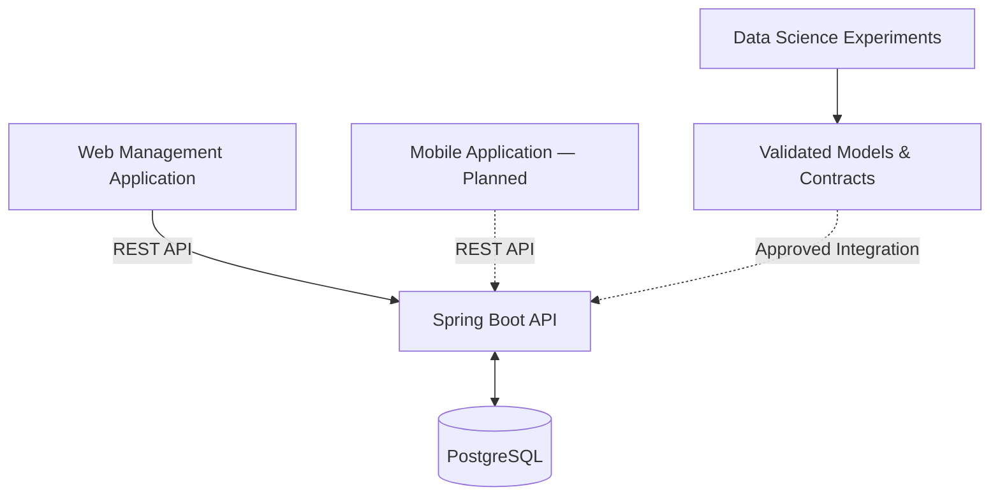

# OpsPilot — Enterprise Operations Platform

**Unified Business Operations & Intelligent Decision Support**

OpsPilot is a multi-branch business operations platform that connects day-to-day workflows, management information, and data-driven decision-making in one system.

**Status:** Active Development · **Architecture:** API-driven Monorepo

## Technology Stack

### Backend & API

### Database & Infrastructure

### Data Science & Machine Learning

*Badges describe the selected technology direction; not every component is implemented yet. Web and mobile frameworks have not been finalized.*

## Project Overview

OpsPilot là nền tảng quản trị vận hành dành cho **doanh nghiệp vừa và nhỏ, chuỗi cửa hàng, đơn vị dịch vụ và tổ chức có nhiều chi nhánh**. Dự án hướng đến việc giải quyết tình trạng dữ liệu phân tán, quy trình thiếu thống nhất và khó giám sát hiệu quả hoạt động khi doanh nghiệp mở rộng.

Hệ thống phục vụ **chủ doanh nghiệp, quản lý chi nhánh, trưởng ca và nhân viên**, với chức năng và phạm vi dữ liệu được kiểm soát theo vai trò. Các nghiệp vụ cốt lõi bao gồm quản lý tổ chức, nhân sự và ca làm, bán hàng, thanh toán, sản phẩm và tồn kho, giao việc, phê duyệt, chi phí và báo cáo. Mục tiêu là tạo ra một nguồn dữ liệu vận hành nhất quán để phối hợp công việc, truy vết thay đổi và hỗ trợ quản lý ở nhiều cấp.

**AI và Data Science** đóng vai trò **hỗ trợ ra quyết định**, không thay thế người quản lý. Nhóm Data Science nghiên cứu dự báo nhu cầu bán hàng, phát hiện bất thường, hỗ trợ bổ sung tồn kho và phân tích hiệu suất. Mô hình chỉ được xem xét tích hợp sau khi đánh giá về chất lượng, khả năng giải thích và chi phí vận hành; các hành động ảnh hưởng đến nghiệp vụ vẫn tuân theo cơ chế phân quyền và phê duyệt.

## Business Domains

| Domain | Scope |
|---|---|
| Organization & Access | Doanh nghiệp, chi nhánh, tài khoản, vai trò và quyền truy cập |
| Workforce & Tasks | Nhân sự, lịch ca, chấm công, công việc và phê duyệt |
| Sales & Inventory | Đơn hàng, thanh toán, sản phẩm, kiểm kê và điều chuyển |
| Financial Operations | Chi phí vận hành và ngân sách |
| Reporting & Analytics | Chỉ số kinh doanh, báo cáo và phân tích hiệu quả |
| AI Decision Support | Dự báo, cảnh báo bất thường và đề xuất có kiểm soát |

## Project Workspaces

| Workspace | Responsibility |
|---|---|
| [`opspilot-management-system-api/`](./opspilot-management-system-api/) | Java / Spring Boot API, nghiệp vụ, bảo mật và PostgreSQL |
| [`opspilot-management-system-web/`](./opspilot-management-system-web/) | Giao diện quản trị và dashboard trên trình duyệt |
| [`opspilot-management-system-mobile/`](./opspilot-management-system-mobile/) | Ứng dụng Android/iOS trong giai đoạn phát triển sau |
| [`opspilot-data-science/`](./opspilot-data-science/) | Phân tích dữ liệu, thử nghiệm và đánh giá mô hình |

## System Overview

*Dashed connections indicate planned integrations. Each workspace is developed and tested independently.*

## Development & Collaboration

OpsPilot is developed collaboratively using **GitHub** for source control, Pull Requests and code review, and **Jira** for task management. Shared database changes, API contracts and model integrations require review before merging. Each workspace maintains its own setup and technical documentation.

**Project status:** Under active development. The descriptions above represent the intended product scope, not a claim that all capabilities are already available.