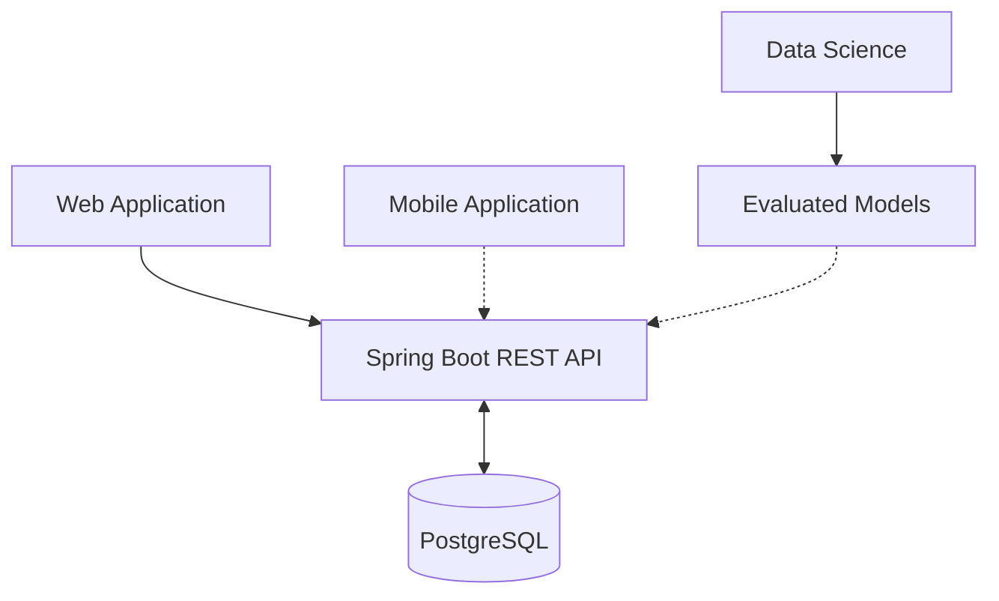

<h1 align="center">OpsPilot — Enterprise Operations Platform</h1>

  <strong>Unified Business Operations & Intelligent Decision Support</strong>

  A unified platform for multi-branch operations, business management, and data-driven decision-making.

  <strong>Status:</strong> Active Development &nbsp; | &nbsp; <strong>Architecture:</strong> API-driven Monorepo

---

<h2 align="center">Technology Stack</h2>

<h3 align="center">Backend & API</h3>

  
  
  
  
  
  

<h3 align="center">Database & Infrastructure</h3>

  
  
  
  
  

<h3 align="center">Data Science & Machine Learning</h3>

  
  
  
  
  

  Technology badges represent the selected stack and research direction. Implementation status varies by component.

---

## Project Overview

OpsPilot là nền tảng quản trị vận hành dành cho **doanh nghiệp vừa và nhỏ, chuỗi cửa hàng, đơn vị dịch vụ và tổ chức có nhiều chi nhánh**. Dự án hướng đến việc giải quyết tình trạng dữ liệu phân tán, quy trình thiếu thống nhất và khó khăn trong việc giám sát hoạt động khi doanh nghiệp mở rộng.

Hệ thống phục vụ **chủ doanh nghiệp, quản lý chi nhánh, trưởng ca và nhân viên**, với chức năng và phạm vi dữ liệu được kiểm soát theo vai trò. Các nghiệp vụ cốt lõi gồm quản lý tổ chức, nhân sự và ca làm, bán hàng, thanh toán, sản phẩm và tồn kho, công việc, phê duyệt, chi phí và báo cáo. OpsPilot hướng đến việc kết nối các quy trình này trên một nguồn dữ liệu thống nhất, hỗ trợ phối hợp công việc, truy vết thay đổi và quản lý hiệu quả kinh doanh.

**Artificial Intelligence và Data Science** được định hướng trở thành lớp hỗ trợ ra quyết định (*Decision Support System*), tập trung dự báo nhu cầu bán hàng, phát hiện bất thường, hỗ trợ bổ sung tồn kho và phân tích hiệu suất vận hành. Các mô hình được nghiên cứu và đánh giá độc lập trước khi tích hợp. AI cung cấp thông tin, cảnh báo và đề xuất có căn cứ, trong khi những quyết định quan trọng vẫn thuộc quyền kiểm soát và phê duyệt của con người.

## Business Domains

| Domain | Scope |
|---|---|
| Organization & Access | Doanh nghiệp, chi nhánh, tài khoản, vai trò và quyền truy cập |
| Workforce & Tasks | Nhân sự, phân ca, chấm công, công việc và phê duyệt |
| Sales & Inventory | Đơn hàng, thanh toán, sản phẩm, tồn kho, kiểm kê và điều chuyển |
| Financial Operations | Chi phí vận hành và ngân sách |
| Reporting & Analytics | Chỉ số kinh doanh, báo cáo và phân tích hiệu quả |
| AI Decision Support | Dự báo nhu cầu, phát hiện bất thường và hỗ trợ quyết định |

## Project Workspaces

| Workspace | Responsibility |
|---|---|
| [Management System API](./opspilot-management-system-api/) | Java, Spring Boot API, nghiệp vụ, bảo mật và PostgreSQL |
| [Management System Web](./opspilot-management-system-web/) | Giao diện quản trị và dashboard |
| [Management System Mobile](./opspilot-management-system-mobile/) | Ứng dụng Android/iOS trong giai đoạn tương lai |
| [Data Science](./opspilot-data-science/) | Phân tích dữ liệu, thử nghiệm và đánh giá mô hình |

## System Architecture

*Solid connections represent the core architecture. Dashed connections represent planned integrations.*

## Development & Collaboration

OpsPilot được phát triển theo mô hình **Monorepo**, trong đó Backend, Web, Mobile và Data Science có phạm vi trách nhiệm, dependencies và quy trình kiểm thử độc lập.

GitHub được sử dụng để quản lý source code, branches, Pull Requests và code review; Jira dùng để tổ chức công việc và theo dõi tiến độ.

**Workflow:** Task Assignment → Development → Testing → Pull Request → Code Review → Merge.

Các thay đổi liên quan đến database schema, API contracts và model integration phải được review trước khi tích hợp. Secrets, credentials, dữ liệu nhạy cảm và model artifacts lớn không được commit vào repository.

---

  <strong>OpsPilot — Connecting Business Operations, Data and Intelligent Decision-Making.</strong>

  Currently under active development.

